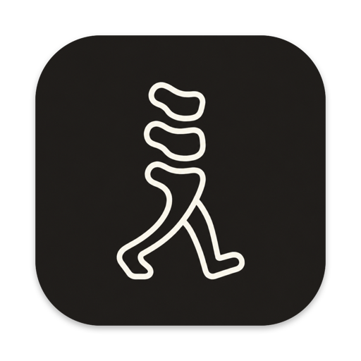

<h1 align="center">Backstride</h1>

A Mac app that won't let you skip your walk break.

<h3 align="center"><a href="https://github.com/eshaands/backstride/releases/latest/download/Backstride-1.4.dmg">⬇ Download for Mac</a></h3>

Needs an Apple silicon Mac on macOS 15 or later. Walk modes need AirPods or Beats with head tracking.

---

If you've ever had a bad back, you've heard it from your physio: "Get up. Walk every 30 minutes."

Simple advice. Almost impossible to follow.

I know, because I've lived with L4-L5 and L5-S1 disc issues. I set timers. I swore I'd stand up after one more email. Then I'd look up three hours later, with my back reminding me exactly how long I'd been sitting.

So I stopped trusting my willpower and built Backstride. There's nothing to remember: it starts by itself when your AirPods are connected and you're using your Mac.

When it's time to move, your Mac's screen slowly blurs and stays that way until you've actually walked for 1 or 2 minutes. Your AirPods confirm the walk, so you can't just click it away. There's an emergency skip for when you really can't leave, and a gentler reminder mode if you don't need the push.

Your work can wait two minutes. Your back has waited long enough.

Backstride is a habit tool, not medical advice. Always follow your doctor's or physio's guidance.

---

Beta. © 2026 Eshaan Singh. All rights reserved. You may download and use Backstride, but you may not copy, modify, resell or redistribute it.

